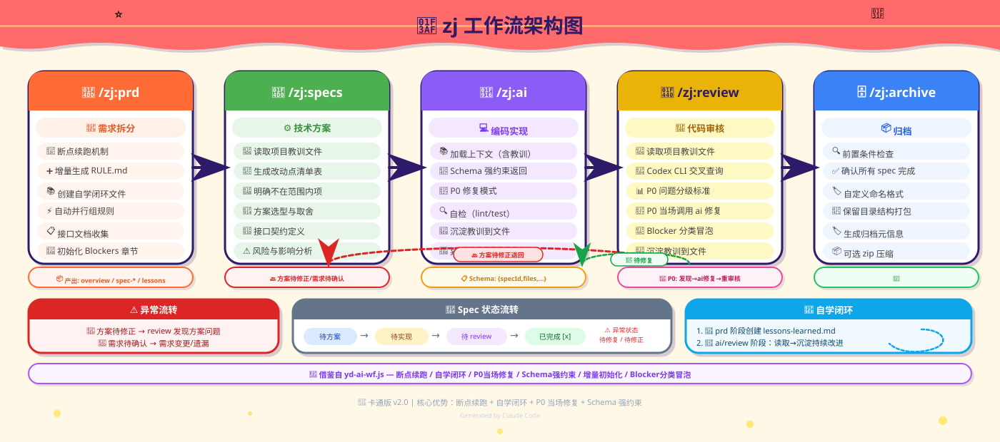

# lyyflow

**多端全链路开发工作流** —— 一条链路打通「需求拆分 → 技术方案 → 编码实现 → 代码审核 → 归档」，带本地知识沉淀（踩坑教训自学习闭环）与断点续跑。



## 它解决什么问题

- **PRD 直接开工容易跑偏**：先拆成粒度合适、可独立验收的 spec（`specs/spec-NNN-*.md`），`specs/overview.md` 作为状态看板中枢
- **多端改动没人统一管**：每端各自有 `CLAUDE-RULE.md` 项目规范，Execute/Review 按端派 subagent，在对应仓库各自实现/审查
- **同一类坑反复踩**：每个 spec 完成后把教训沉淀到 `.lyyflow-local/lessons-learned.md`（本地私有，不入 git），后续 agent 开工前自动加载
- **审一半没人管 P0**：review 报 P0 当场派修复 agent 只修 P0，修完复跑 review 验证；修不掉的冒泡给人工
- **中途断了从头再来**：靠 overview.md 的 `[x]` 标记 + 状态机做断点续跑，重跑只处理未完成的 spec

## 流程总览

```
/lyyflow:prd      读需求来源(文件/URL/PDF/文本)拆功能点 spec
   ↓
/lyyflow:specs    每个 spec 定位代码、分析改动点、写可落地技术方案
   ↓
/lyyflow:ai       按技术方案实现代码,自检 lint/test/验收标准
   ↓
/lyyflow:review   3 层路由审核(见下),P0 当场修复
   ↓
/lyyflow:archive  全部完成后归档到 ~/lyyflow-archives(可配)
```

**Review 3 层路由**（省 Codex 配额）：

| Tier | 触发 | 审核方式 |
|------|------|---------|
| core | 鉴权/支付/契约/并发等高风险 | Codex review + adversarial review |
| standard | 普通功能改动 | 仅 Codex review |
| trivial | 纯重构/typo/样式 | Jev(TypeSafe System One)轻校验,不耗 Codex 配额;触发升级条件自动转 standard |

## 安装

```bash
claude plugin marketplace add Kora1006/lyyflow
claude plugin install lyyflow@lyyflow
```

不想建 marketplace 也可以直接试用：

```bash
claude --plugin-dir /path/to/lyyflow
```

## 使用

### 单命令使用（交互式，适合人工主导）

```
/lyyflow:prd <需求来源:文件路径|URL|PDF|需求描述>
/lyyflow:specs [spec编号]
/lyyflow:ai <spec编号>
/lyyflow:review <spec编号>
/lyyflow:archive [命名]
```

### Workflow 编排（无人值守，一条链跑完）

让 Claude 调用 Workflow 工具（`/lyyflow:lyyflow`），或在对话中说「用 lyyflow 跑这个需求」：

```js
Workflow({ name: 'lyyflow', args: {
  projectDir: '/abs/project',      // 必填:项目根(specs/ 在此)
  prdSource: '/path/prd.md',       // 可选:需求来源;传则进入 PRD 段
  feature: 'spec-001',             // 可选:只处理单个 spec(Specs→Execute→Review)
  archive: true,                   // 可选:全部完成后归档
  archiveName: '20261013-001',     // 可选:归档命名,默认 YYYYMMDD-序号
  archiveRoot: 'D:/archives',      // 可选:归档根目录,默认 ~/lyyflow-archives
  skip: ['PRD'],                   // 可选:强制跳过的阶段(仅 PRD 可跳)
}})
```

## 依赖

| 依赖 | 必需性 | 说明 |
|------|--------|------|
| **codex-plugin-cc**（OpenAI Codex 插件） | review 阶段必需 | 安装:`/plugin marketplace add openai/codex-plugin-cc` → `/plugin install codex@openai-codex` → `/codex:setup`。未装时 review 会冒泡提示,不静默降级 |
| **Jev / TypeSafe System One**（`TYPESAFE_API_KEY`） | 可选 | 只影响 review 的 trivial 轻校验层。未配置时自动降级 core(Codex 全套),流程不受阻 |

## 目录约定

```
<projectDir>/
├── specs/                  # 团队可见:overview.md / spec-NNN-*.md / api-contracts.md / tracking-events.md / lessons-learned.md(公开快照)
└── .lyyflow-local/         # 本地私有,不入 git:lessons-learned.md(主版本) / notes/ / secrets/
```

`.lyyflow-local/` 由 Bootstrap 阶段自动建立：写入 `.git/info/exclude` + pre-commit hook 拦截 `git add -f`，并跑 `git ls-files` 安全检查，确保本地教训不外泄。

## 从 zj-wf 迁移

本项目由 `zj-wf` 更名而来。旧项目迁移注意：

- 本地知识目录从 `.zj-local/` 改为 `.lyyflow-local/`：把旧项目的 `.zj-local/` 重命名即可，`.git/info/exclude` 与 pre-commit hook 会在下次运行 Bootstrap 时自动更新
- 归档根目录不再硬编码 `D:\projectSessions`，默认 `~/lyyflow-archives`；想沿用旧路径传 `archiveRoot: 'D:/projectSessions'`

## 已知约定（按需修改）

- 埋点模板假设 `qt.QTEventTracking()` 上报格式（key/pageId/moduleId/featureId）——如果你的项目用别的埋点 SDK，编辑 `commands/prd.md` 中的「埋点文档模板」与 `commands/specs.md` 中的「埋点方案」章节即可
- 需求来源支持禅道/网页 URL（WebFetch 抓取）

## License

MIT
